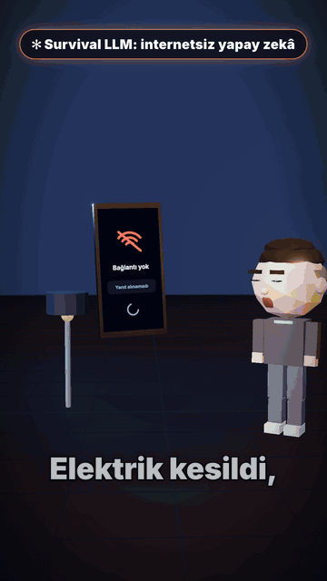
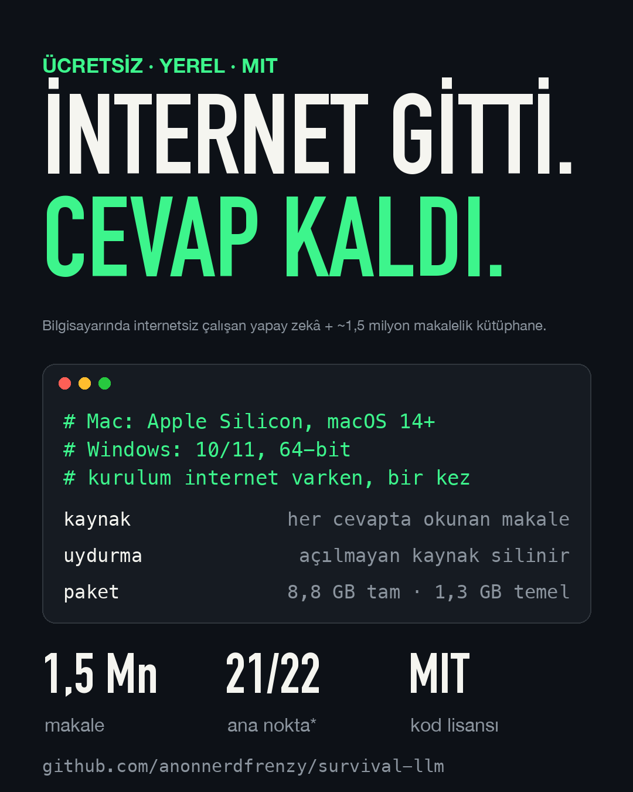

# Elektrik gitti, internet gitti. Telefondaki yapay zekâ tek kelime cevap vermedi.

1,5 milyon makale. Sıfır internet.

Survival LLM.

Açık kaynak bir uygulama, modeli ve kütüphaneyi bilgisayarına kuruyor:
→ ~1,5 milyon makale: ilk yardım, tıp rehberleri, afet kılavuzları, Vikipedi'nin en çok okunanları, iFixit, wikiHow
→ soruyu yerel kütüphanede arıyor, cevabın dayandığı paragrafı işaretli açıyor
→ model açmadığı bir kaynağı yazarsa uygulama o satırı siliyor, gerçekten okuduklarını koyuyor
→ belleğe göre model: 16-31 GB → 6 GB, 32-96 GB Mac → 18 GB, 128 GB+ → 80 GB
→ sohbet sunucusu yalnız 127.0.0.1'de; notlar ve dosyalar bilgisayarında
→ Mac (Apple Silicon, macOS 14+) ve Windows 10/11; Linux sürümü yok

Geliştiricinin testi (22 kesinti/ilk yardım sorusu, kör hakemli): Qwen3.8 27B 21/22 ana noktada doğru, zararlı cevap 0, cevap başına ~40 sn (M4 Max 128 GB). Küçük Granite 3B modeli devrilmiş elektrik hattından "3 feet (~1 m) uzak dur" dediği için listeden çıkarılmış (kılavuz 35 feet, ~10 m).

**📊 Rakamlarla:**
• 1,5 Mn makale
• 21/22 ana nokta*
• MIT kod lisansı

**⚙️ Nasıl başlarsın:**

**📌 Kısa notlar:**
• kaynak: her cevapta okunan makale
• uydurma: açılmayan kaynak silinir
• paket: 8,8 GB tam · 1,3 GB temel

**✨ Öne çıkanlar:**
• ilk yardım, tıp, afet kılavuzları, Vikipedi
• açılmayan kaynağı yazarsa satır siliniyor
• bellek → model: 32-96 GB Mac'e 18 GB

İnternet kesilse elinizde hangi bilgi kalır?

[▶ Tam kalite video: video.mp4](video.mp4)

## Videoda adım adım

1. Adı Survival LLM, bilgisayarında internetsiz çalışan ücretsiz bir yapay zekâ asistanı ve hazır bir kütüphane.
2. Yaklaşık 1,5 milyon makale geliyor, ilk yardım, tıp, afet kılavuzları ve Vikipedi dahil.
3. İnternet kapalıyken soruyorsun, kütüphanede arıyor, cevabı veriyor ve dayandığı paragrafı işaretli açıyor.
4. Model açmadığı bir kaynağı yazarsa uygulama onu siliyor, okuduğu makaleleri koyuyor.
5. Belleğe göre model seçiyor, 32 ile 96 gigabayt arası Mac'e 18 gigabaytlık model iniyor.
6. Geliştiricinin testinde bu model 22 sorunun 21'inde ana noktayı tuttu.
7. Bu bilgisayarda 36 gigabayt bellek var, macOS 14 isteniyor, 27 kurulu.
8. Kurulumu internet varken bir kez yapıyorsun, tam kütüphane 8,8 gigabayt iniyor.

## Kaynak

- https://github.com/anonnerdfrenzy/survival-llm

## Lisans

Bu depodaki video, kart ve metinler MIT lisanslıdır (LICENSE). Anlatılan aracın kendi lisansı kendi deposundadır.
